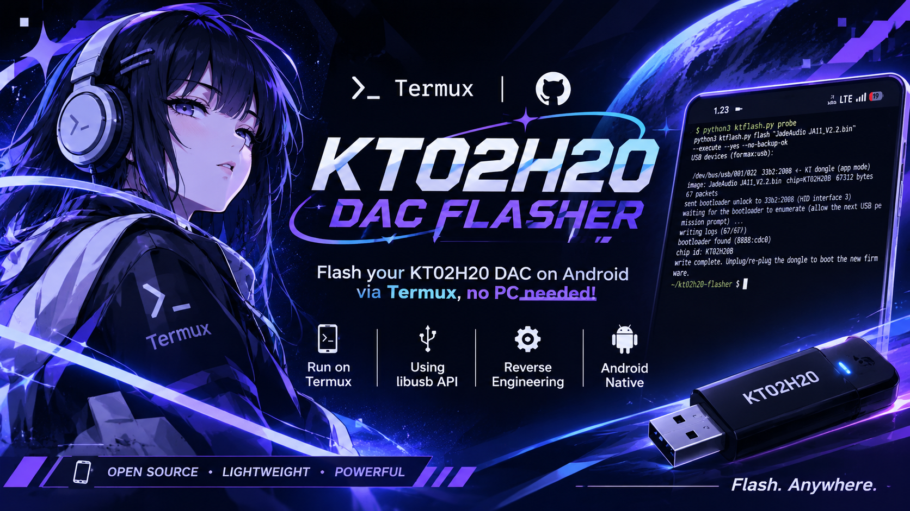

<p align="center">
  
</p>

<h1 align="center">KT02H20-FLASHER-RE</h1>

<p align="center">
  Community-driven firmware flasher for <b>KTMicro KT02H20</b> USB DAC dongles.<br>
  Flash straight from your <b>Android phone with Termux</b> — no PC, no root.
</p>

<p align="center">
  
  
  
</p>

> **Origin:** this project is the result of **reverse engineering** of the vendor's KT_USB_BOOT updater protocol and is a **fork of / built on the research by [txtsamu](https://github.com/txtsamu)**. Full credit to the original author. This fork adds native Android/Termux support (`termux-usb` + libusb) and a safer CLI workflow.

---

## ⚠️ DISCLAIMER — READ BEFORE USING

**Flashing firmware can permanently damage ("brick") your device. Use this tool entirely at your own risk.**

- This is an **unofficial, community-made** tool. It is **not affiliated with, endorsed by, or supported by** KTMicro, FiiO, Jade Audio, or any other vendor.
- The software is provided **"as is", without warranty of any kind**. The authors and contributors accept **no responsibility** for bricked devices, data loss, voided warranties, or any other damage.
- **The original firmware CANNOT be backed up.** The KT02H20 bootloader has no read command. After flashing, the stock firmware is gone unless you already have a copy of the stock image.
- **Only flash an image made for your exact hardware.** The tool checks the image magic, size field and chip ID (`KT02H20B`) *before* erasing, but it cannot know whether a compatible-looking image is right for your specific model.
- **Never interrupt a flash.** Use a charged phone, a good cable, and don't touch the connector while writing.
- If a write fails, the dongle normally stays in bootloader mode (the boot ROM is not overwritten) and can be re-flashed with a valid image. **This is not guaranteed.**

If you are not comfortable with these risks, **do not use this tool.**

---

## Features

- 📱 **Runs on Android/Termux** via `termux-usb` — no root, no PC
- 🖥️ Also works on Linux, macOS and Windows
- 🛡️ **Dry run by default** — writing needs `--execute --yes --no-backup-ok`
- ✅ Image validation (magic, size field, chip ID, per-packet CRC) **before** anything is erased
- 🔁 Failed writes leave the device in bootloader mode so you can retry

## Supported devices

| Device | App-mode USB ID | Status |
|---|---|---|
| JadeAudio JA11 (KT02H20B) | `31b2:2008` | Tested from Android/Termux, firmware V2.2 |
| Other KT02H20-based dongles | usually `31b2:xxxx` | Untested — may work |

Bootloader mode always enumerates as `8888:cdc0` (CDC-ACM serial).
If your dongle uses another vendor ID (e.g. `2972`), pass it **before** the subcommand: `--vid 0x2972`.

You must supply the firmware image (`.bin`) yourself, obtained from your vendor. Images are **not** distributed with this project.

---

## Quick start on Android (Termux)

### Requirements

- Android phone with **USB OTG** support
- [Termux](https://f-droid.org/packages/com.termux/) and [Termux:API](https://f-droid.org/packages/com.termux.api/) — install both from the **same source** (e.g. F-Droid)
- A USB-C cable/adapter that lets the phone act as USB host
- A firmware image for your dongle

### 1. Install dependencies

```sh
pkg install python git libusb termux-api
pip install "libusb1>=3"
```

`libusb1` **3.0 or newer** is required (older versions can't open Android file descriptors).
If Python reports `libusb-1.0.so not found`:

```sh
export LD_LIBRARY_PATH=$PREFIX/lib
```

### 2. Get the tool

```sh
git clone https://github.com/dragonzords/KT02H20-FLASHER-RE.git
cd KT02H20-FLASHER-RE
```

Put your firmware image in this folder (or use its full path).

### 3. Check that the dongle is detected

```sh
python3 ktflash.py probe
```

Expected output (IDs may differ):

```
USB devices (termux-usb):
  /dev/bus/usb/001/022  31b2:2008 <- KT dongle (app mode)
```

Android asks for USB permission — tap **Allow**.

### 4. Validate the image (safe, sends nothing)

```sh
python3 ktflash.py image "firmware.bin"
python3 ktflash.py flash "firmware.bin"        # dry run, nothing is written
```

Make sure the chip ID matches your dongle (`KT02H20B`) and the size/packet count look sane.

### 5. Flash

```sh
python3 ktflash.py flash "firmware.bin" --execute --yes --no-backup-ok
```

With a non-default vendor ID:

```sh
python3 ktflash.py --vid 0x2972 flash "firmware.bin" --execute --yes --no-backup-ok
```

What happens:

1. The tool asks for USB permission for the dongle (**Allow**) and sends the HID "enter bootloader" report.
2. The dongle re-enumerates as `8888:cdc0`. This is a **new USB device**, so Android shows a **second permission prompt** — tap **Allow** (the tool waits up to 60 s).
3. The tool does the handshake, verifies the chip ID, then erases and writes the image with a progress indicator.
4. When you see `write complete`, **unplug and re-plug the dongle** to boot the new firmware.

---

## Command reference

```
ktflash.py [--vid VID] <command> [options]
```

| Command | Description |
|---|---|
| `probe` | List KT dongles and bootloader devices |
| `image <file>` | Validate a firmware image and show its packet plan |
| `unlock` | Switch the dongle into bootloader mode (no flashing) |
| `flash <file>` | Flash an image. **Dry run unless `--execute` is given** |
| `snapshot [out.json]` | Save a device identity snapshot (desktop only; **not** a firmware backup) |

Flash options:

| Option | Meaning |
|---|---|
| `--execute` | Actually write (otherwise dry run) |
| `--yes` | Confirm you want to write |
| `--no-backup-ok` | Acknowledge the original firmware cannot be backed up |
| `--base ADDR` | Base address (default `0`) |
| `--port PORT` | Serial port (desktop only; ignored on Termux) |

Writing requires **all three** of `--execute --yes --no-backup-ok`.

---

## Desktop usage (Linux / macOS / Windows)

```sh
pip install pyserial hidapi
python3 ktflash.py probe
python3 ktflash.py flash "firmware.bin" --execute --yes --no-backup-ok
```

- **Linux:** the HID step uses `/dev/hidraw`; on permission errors add a udev rule for the dongle or run with `sudo`.
- **Windows / macOS:** `hidapi` handles the HID step, `pyserial` the bootloader.

---

## Troubleshooting

| Problem | What to try |
|---|---|
| `termux-usb not found` | `pkg install termux-api` and install the **Termux:API** app |
| `python-libusb1 missing` / `libusb1 is too old` | `pkg install libusb` and `pip install -U "libusb1>=3"` |
| `libusb-1.0.so not found` | `export LD_LIBRARY_PATH=$PREFIX/lib` |
| `no matching dongle ... found via termux-usb` | Check OTG/cable, re-plug, tap **Allow**, or pass the right `--vid` |
| `no answer for ... (USB permission denied?)` | Re-plug the dongle and allow USB access when prompted |
| `bootloader did not show up / was not authorised within 60s` | You missed the second permission prompt — re-plug and run again |
| `no handshake ack (0x78)` | The bootloader accepts the handshake **once per boot**. Unplug, re-plug, retry |
| `chip ... does not match image ...` | Wrong firmware for this chip. The tool aborted **before** erasing |
| `write failed at packet N/M` | Re-plug (the dongle should stay in bootloader mode) and re-run with a valid image |

### Recovery

A failed or interrupted write normally leaves the dongle in bootloader mode (`8888:cdc0`) because the boot ROM is not touched. Re-plug it and run `flash` again with a valid image. `probe` labels the device as the bootloader when it sees it.

---

## How it works

Protocol notes from reverse engineering of the vendor KT_USB_BOOT updater:

1. **Enter bootloader** — HID output report `0x54` with payload `"12345678"` makes the dongle re-enumerate as a CDC-ACM serial device, USB `8888:cdc0`.
2. **Handshake** — `KTM` is re-sent until the bootloader answers `0x78`.
3. **Chip check** — `CHP` returns the chip ID, which must match the image header (`KT02H20B`).
4. **Erase / setup** — erase block, `PWO`, `KSTA` (the point of no return).
5. **Data** — 1 KiB packets with header, address and CRC-32 (reflected, poly `0xEDB88320`, init `0`, no final XOR), each acknowledged with `0xA5`. The 16-byte image header is written **last**, so an interrupted flash stays unbootable instead of half-valid.
6. **Finish** — `STP`, then `RESET`.

Android apps get no `/dev/hidraw` or `/dev/ttyACM*` nodes. On Termux the tool therefore re-launches itself through `termux-usb`, which hands it an open USB file descriptor; the HID report and the CDC-ACM bulk transfers are then done with libusb on that descriptor. Because the dongle re-enumerates after the unlock, the two devices (normal mode, then bootloader) are handled one after another.

---

## Credits

- **[txtsamu](https://github.com/txtsamu)** — original research and tooling this project is forked from.
- Protocol details derived from reverse engineering of the vendor KT_USB_BOOT updater.

KTMicro, FiiO, Jade Audio and all other product names are trademarks of their respective owners and are used for identification only.
